# LavaSR.AXERA

[LavaSR v2](https://github.com/ysharma3501/LavaSR) 的 AX650（NPU3）量化与板端部署工程。输入 8–48 kHz 语音，输出 48 kHz；提供 3 个 axmodel、Python/C++ SDK 和预编译可执行文件。

- HuggingFace: https://huggingface.co/HY-2012/LavaSR.AXERA
- GitHub: https://github.com/ZY-2012/LavaSR.AXERA
- 上游: https://github.com/ysharma3501/LavaSR / https://huggingface.co/YatharthS/LavaSR

## 目录

- 快速开始
- 结果
- 推理速度
- 模型转换
- 数据来源
- License

## 快速开始（AX650 板端）

从 HuggingFace 下载 `models/`、`bin/`、`python/`、`samples/`，在包根目录运行：

```bash
# C++（默认）
bash run_ax650.sh samples/listen/8k/OSR_us_000_0010_input_8k.wav output.wav --no-denoise

# Python SDK
bash run_ax650.sh samples/listen/8k/OSR_us_000_0010_input_8k.wav output.wav --python --no-denoise
```

输入支持 8–48 kHz，输出固定 48 kHz。`--no-denoise` 仅做 BWE；去掉会同时跑 UL-UNAS 降噪。

## 结果

### 8 kHz 输入（Open Speech / Samplelib）

#### English

**OSR_us_000_0010**

| 版本 | 输入 | LavaSR 输出 |
|---|---|---|
| 8k | [▶](https://huggingface.co/HY-2012/LavaSR.AXERA/resolve/main/samples/listen/8k/OSR_us_000_0010_input_8k.wav)<br>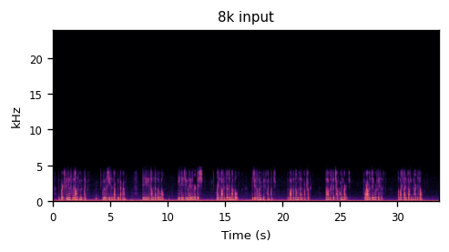 | [▶](https://huggingface.co/HY-2012/LavaSR.AXERA/resolve/main/samples/listen/48k_from8k/OSR_us_000_0010_output_48k.wav)<br>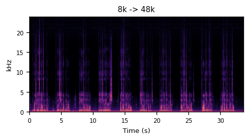 |

**OSR_us_000_0013**

| 版本 | 输入 | LavaSR 输出 |
|---|---|---|
| 8k | [▶](https://huggingface.co/HY-2012/LavaSR.AXERA/resolve/main/samples/listen/8k/OSR_us_000_0013_input_8k.wav)<br>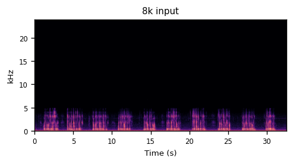 | [▶](https://huggingface.co/HY-2012/LavaSR.AXERA/resolve/main/samples/listen/48k_from8k/OSR_us_000_0013_output_48k.wav)<br>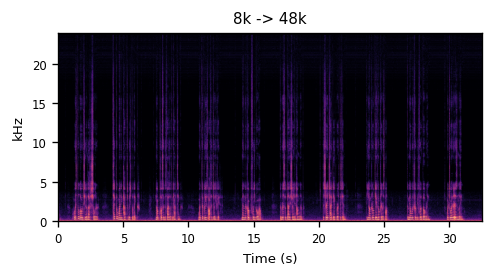 |

**OSR_us_000_0057**

| 版本 | 输入 | LavaSR 输出 |
|---|---|---|
| 8k | [▶](https://huggingface.co/HY-2012/LavaSR.AXERA/resolve/main/samples/listen/8k/OSR_us_000_0057_input_8k.wav)<br> | [▶](https://huggingface.co/HY-2012/LavaSR.AXERA/resolve/main/samples/listen/48k_from8k/OSR_us_000_0057_output_48k.wav)<br>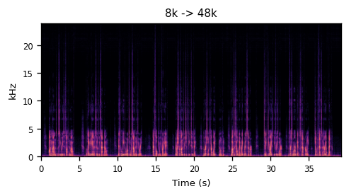 |

**OSR_us_000_0059**

| 版本 | 输入 | LavaSR 输出 |
|---|---|---|
| 8k | [▶](https://huggingface.co/HY-2012/LavaSR.AXERA/resolve/main/samples/listen/8k/OSR_us_000_0059_input_8k.wav)<br>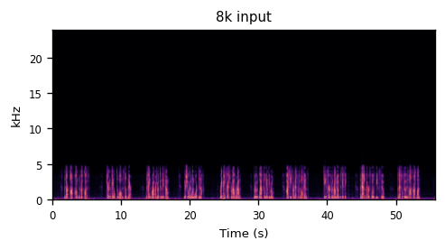 | [▶](https://huggingface.co/HY-2012/LavaSR.AXERA/resolve/main/samples/listen/48k_from8k/OSR_us_000_0059_output_48k.wav)<br>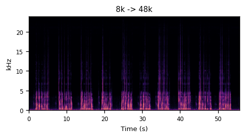 |

#### Chinese

**OSR_cn_000_0072**

| 版本 | 输入 | LavaSR 输出 |
|---|---|---|
| 8k | [▶](https://huggingface.co/HY-2012/LavaSR.AXERA/resolve/main/samples/listen/8k/OSR_cn_000_0072_input_8k.wav)<br>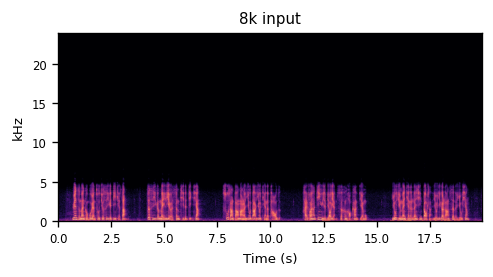 | [▶](https://huggingface.co/HY-2012/LavaSR.AXERA/resolve/main/samples/listen/48k_from8k/OSR_cn_000_0072_output_48k.wav)<br>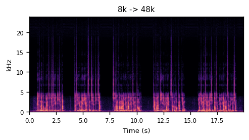 |

**OSR_cn_000_0073**

| 版本 | 输入 | LavaSR 输出 |
|---|---|---|
| 8k | [▶](https://huggingface.co/HY-2012/LavaSR.AXERA/resolve/main/samples/listen/8k/OSR_cn_000_0073_input_8k.wav)<br>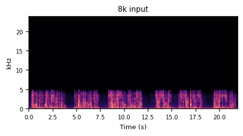 | [▶](https://huggingface.co/HY-2012/LavaSR.AXERA/resolve/main/samples/listen/48k_from8k/OSR_cn_000_0073_output_48k.wav)<br>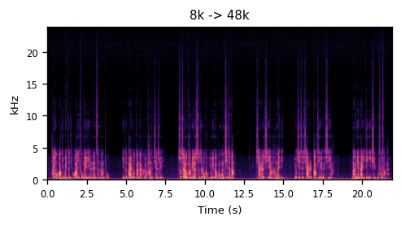 |

**OSR_cn_000_0074**

| 版本 | 输入 | LavaSR 输出 |
|---|---|---|
| 8k | [▶](https://huggingface.co/HY-2012/LavaSR.AXERA/resolve/main/samples/listen/8k/OSR_cn_000_0074_input_8k.wav)<br>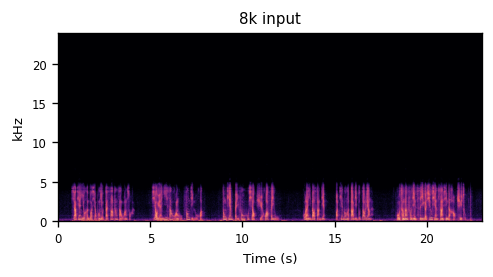 | [▶](https://huggingface.co/HY-2012/LavaSR.AXERA/resolve/main/samples/listen/48k_from8k/OSR_cn_000_0074_output_48k.wav)<br>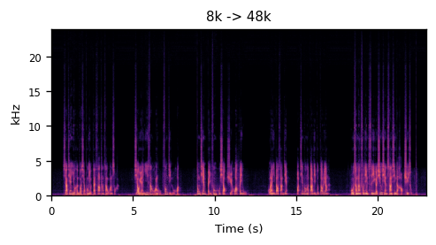 |

**OSR_cn_000_0075**

| 版本 | 输入 | LavaSR 输出 |
|---|---|---|
| 8k | [▶](https://huggingface.co/HY-2012/LavaSR.AXERA/resolve/main/samples/listen/8k/OSR_cn_000_0075_input_8k.wav)<br>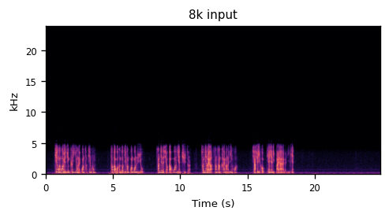 | [▶](https://huggingface.co/HY-2012/LavaSR.AXERA/resolve/main/samples/listen/48k_from8k/OSR_cn_000_0075_output_48k.wav)<br>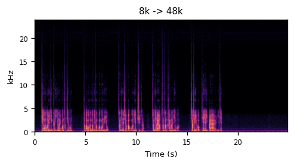 |

#### Samplelib（1 分钟，频谱图为前 10 s）

**samplelib_speech_1m**

| 版本 | 输入 | LavaSR 输出 |
|---|---|---|
| 8k | [▶](https://huggingface.co/HY-2012/LavaSR.AXERA/resolve/main/samples/listen/8k/samplelib_speech_1m_input_8k.wav)<br>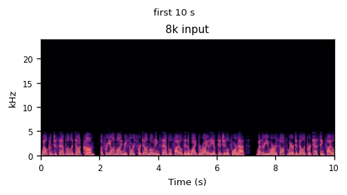 | [▶](https://huggingface.co/HY-2012/LavaSR.AXERA/resolve/main/samples/listen/48k_from8k/samplelib_speech_1m_output_48k.wav)<br>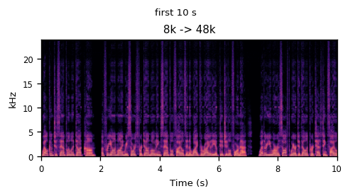 |

### 16 kHz 参照（人声）

同一批人声降采样到 16 kHz 后输入；8k 行为官方 8k 输入，16k 行为 16k 输入。

**speech_2**

| 版本 | 输入 | LavaSR 输出 |
|---|---|---|
| 8k | [▶](https://huggingface.co/HY-2012/LavaSR.AXERA/resolve/main/samples/listen/8k/speech_2_input_8k.wav)<br>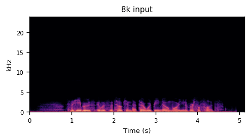 | [▶](https://huggingface.co/HY-2012/LavaSR.AXERA/resolve/main/samples/listen/48k_from8k/speech_2_output_48k.wav)<br>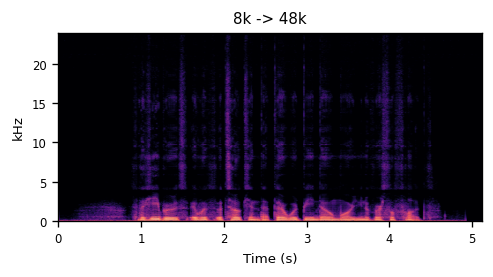 |
| 16k | [▶](https://huggingface.co/HY-2012/LavaSR.AXERA/resolve/main/samples/listen/16k/speech_2_input_16k.wav)<br>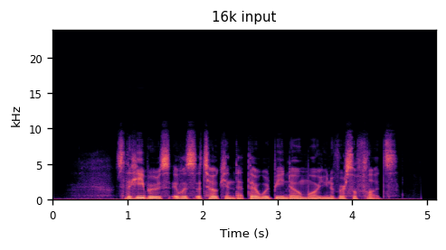 | [▶](https://huggingface.co/HY-2012/LavaSR.AXERA/resolve/main/samples/listen/48k_from16k/speech_2_output_48k.wav)<br>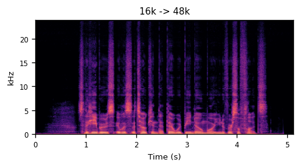 |

**speech_3**

| 版本 | 输入 | LavaSR 输出 |
|---|---|---|
| 8k | [▶](https://huggingface.co/HY-2012/LavaSR.AXERA/resolve/main/samples/listen/8k/speech_3_input_8k.wav)<br>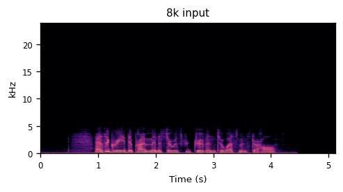 | [▶](https://huggingface.co/HY-2012/LavaSR.AXERA/resolve/main/samples/listen/48k_from8k/speech_3_output_48k.wav)<br>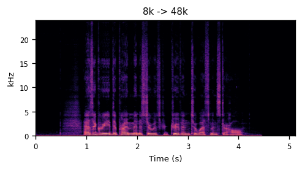 |
| 16k | [▶](https://huggingface.co/HY-2012/LavaSR.AXERA/resolve/main/samples/listen/16k/speech_3_input_16k.wav)<br>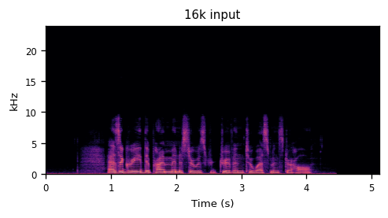 | [▶](https://huggingface.co/HY-2012/LavaSR.AXERA/resolve/main/samples/listen/48k_from16k/speech_3_output_48k.wav)<br> |

### 带噪输入（降噪 + BWE）

**OSR_us_000_0010 + 10 dB noise**

| 版本 | 带噪输入 | LavaSR 输出（降噪 + BWE） |
|---|---|---|
| 8k | [▶](https://huggingface.co/HY-2012/LavaSR.AXERA/resolve/main/samples/listen/8k/OSR_us_000_0010_noisy_input_8k.wav)<br>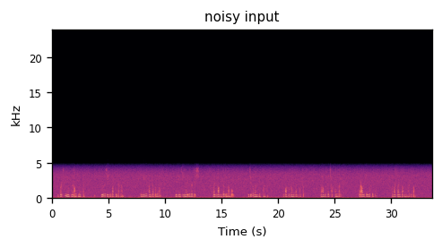 | [▶](https://huggingface.co/HY-2012/LavaSR.AXERA/resolve/main/samples/listen/48k_noisy/OSR_us_000_0010_noisy_output_48k.wav)<br>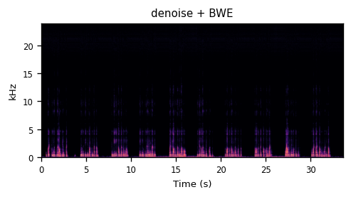 |

**OSR_cn_000_0072 + 10 dB noise**

| 版本 | 带噪输入 | LavaSR 输出（降噪 + BWE） |
|---|---|---|
| 8k | [▶](https://huggingface.co/HY-2012/LavaSR.AXERA/resolve/main/samples/listen/8k/OSR_cn_000_0072_noisy_input_8k.wav)<br>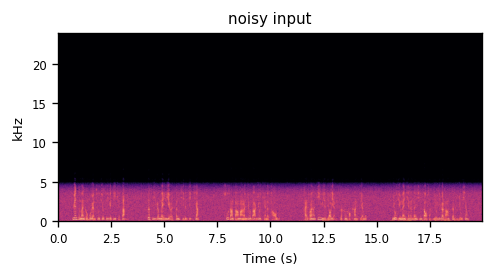 | [▶](https://huggingface.co/HY-2012/LavaSR.AXERA/resolve/main/samples/listen/48k_noisy/OSR_cn_000_0072_noisy_output_48k.wav)<br>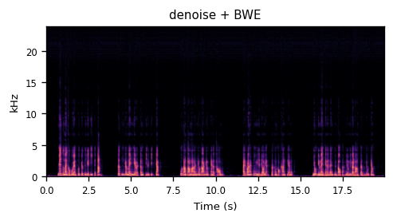 |

**speech_2 + 10 dB noise**

| 版本 | 带噪输入 | LavaSR 输出（降噪 + BWE） |
|---|---|---|
| 16k | [▶](https://huggingface.co/HY-2012/LavaSR.AXERA/resolve/main/samples/listen/16k/speech_2_noisy_input_16k.wav)<br>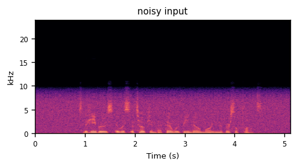 | [▶](https://huggingface.co/HY-2012/LavaSR.AXERA/resolve/main/samples/listen/48k_noisy/speech_2_noisy_output_48k.wav)<br>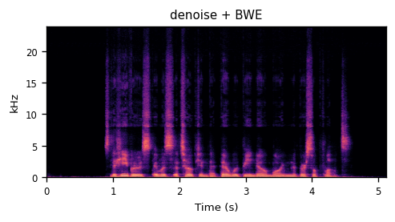 |

## 推理速度：RTF

| 链路 | Python RTF | C++ RTF |
|---|---:|---:|
| 降噪 + BWE | 0.278 | **0.061** |
| 仅 BWE | 0.103 | **0.039** |

## 模型转换

```bash
python model_convert/export_onnx.py --origin-dir origin/LavaSR --hf-dir origin/LavaSR_HF
python model_convert/make_calib.py --audio <wavs> --out-dir build/calib
python model_convert/make_decoder_calib.py
python model_convert/prepare_compile.py
PULSAR2_IMAGE=pulsar2:8.0 bash model_convert/compile.sh
```

详见 `model_convert/README.md`（Pulsar2 8.0）。

## 数据来源

- Open Speech Repository（English / Chinese 8k）：http://voiptroubleshooter.com/open_speech/index.html
- Samplelib speech 1 min：https://samplelib.com/mp3/sample-speech-1m.mp3
- 16 kHz 参照：公开人声样例经 48k->16k 降采样。

## License

Apache-2.0；KissFFT BSD-3-Clause。
